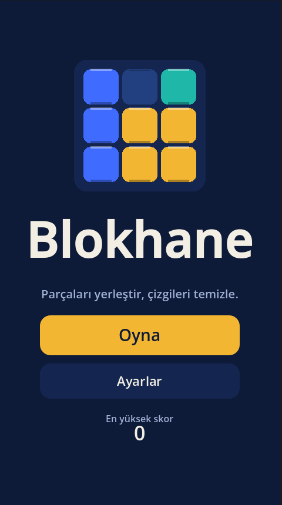
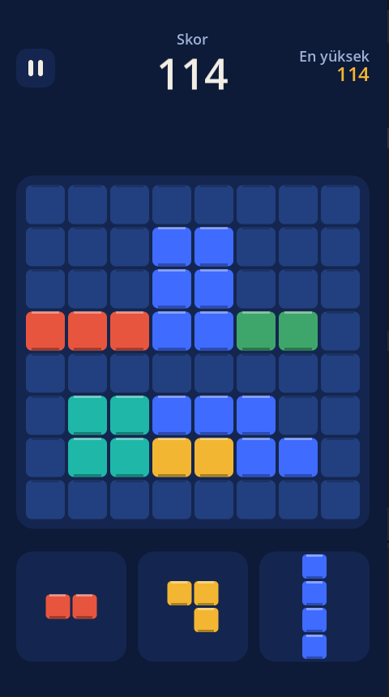

# Blokhane

Blokhane, 8x8 tahtada parçaları sürükleyip bırakarak satır ve sütun temizlediğiniz bir blok bulmacasıdır.

## Ekran görüntüleri





## Nasıl oynanır

1. Alt tepsiden bir parçayı sürükleyin.
2. Parçayı tahtada uygun bir yere bırakın.
3. Bir satırı veya sütunu doldurarak temizleyin.
4. Arka arkaya çizgi temizleyerek kombo skorunu artırın.
5. Hiçbir parça tahtaya sığmadığında oyun sona erer.

## Özellikler

- Açık ve koyu tema.
- Kalıcı en yüksek skor.
- Tema, ses ve rekor sıfırlama ayarları.
- Ses efektleri.

## Gereksinimler

- Godot 4.7.

## Kaynaktan çalıştırma

Projeyi Godot 4.7 ile açın ve `scenes/Main.tscn` sahnesini çalıştırın.

İçe aktarma ve smoke testlerini proje kökünde çalıştırın:

```sh
godot --headless --editor --path . --quit
godot --headless --path . --script res://tests/smoke_test.gd
```

## Linux AppImage

Godot 4.7 Linux dışa aktarma şablonlarını ve `appimagetool` aracını kurun. `export_presets.cfg.example` dosyasını `export_presets.cfg` olarak kopyalayın; yerel dışa aktarma ayarları `.gitignore` kapsamındadır.

```sh
chmod +x tools/build_linux.sh
./tools/build_linux.sh
```

Uygulamayı çalıştırmak için:

```sh
chmod +x build/Blokhane-x86_64.AppImage
./build/Blokhane-x86_64.AppImage
```

## Proje yapısı

```text
.
├── scenes/       Godot sahneleri
├── scripts/      Oyun ve arayüz betikleri
├── sounds/       Ses efektleri
├── templates/    Tasarım SVG dosyaları (yerel, depoya dahil değil)
├── assets/       Dağıtım simgesi
├── tests/        Headless smoke testleri
├── tools/        Linux AppImage derleme betiği
└── docs/         Belgeler ve ekran görüntüleri
```

## Katkı

Hata bildirimleri ve katkılar memnuniyetle karşılanır. Hata raporlarında tekrar üretme adımlarını ve Godot sürümünü belirtin.

## Lisans

Kod MIT lisanslıdır; varlıkların kaynak ve lisans notları için [ASSETS.md](ASSETS.md) dosyasına bakın.
